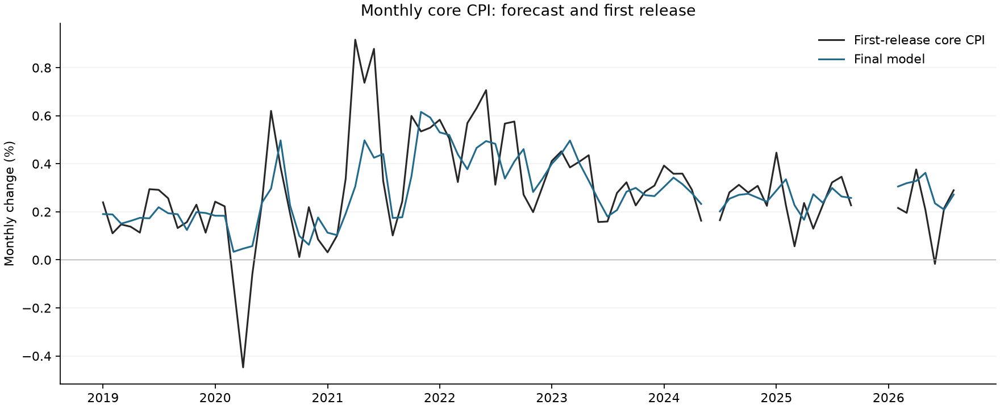

# Monthly core CPI forecasting

A Python project testing whether housing, used-car, factory and other economic data improve forecasts of U.S. core CPI. I built it to learn how to work with financial data, compare models and investigate large forecasting errors.

**Question:** At the end of a month, how well can we predict that month's core CPI change before its release?

The final model forecasts seven parts of core CPI separately, then combines them using published weights. It uses ridge regression—linear regression with a penalty that discourages large coefficients—and a few economically motivated restrictions. Simple forecasts remain useful benchmarks.

## Results

Mean absolute error (MAE), in **percentage points of monthly inflation**. An error of 0.10 pp means forecasting 0.30% when the release is 0.40%.

| Model | 2019–24 · 71 months | 2025–Aug 2026 · 16 months |
|---|---:|---:|
| Final component model | **0.1003** | 0.0930 |
| Earlier component model | 0.1102 | 0.0967 |
| CPI + factory regression | 0.1118 | 0.1117 |
| Average of the last 12 months | 0.1370 | **0.0827** |

All models are compared on the same dates. **Both periods were inspected during development.** These are historical development results, not an untouched test or live forecasting record. Zillow and Manheim inputs use revised histories. The simple average wins in the recent period; the final model still misses some reopening months badly.



[Yearly errors](results/yearly_errors.png) · [Every forecast](results/forecasts.csv) · [Excluded months](results/exclusions.csv) · [Full metrics](results/metrics.json)

## Reproduce the results

Use **Python 3.13**. No API keys, paid accounts, Git LFS or source downloads are required for this route. Run these commands from the repository folder.

**macOS / Linux**

```bash
python3.13 -m venv .venv
source .venv/bin/activate
python -m pip install -r requirements.txt
python -m cpi_forecast reproduce
python -m unittest discover -s tests -v
```

**Windows PowerShell**

```powershell
py -3.13 -m venv .venv
.venv\Scripts\python.exe -m pip install -r requirements.txt
.venv\Scripts\python.exe -m cpi_forecast reproduce
.venv\Scripts\python.exe -m unittest discover -s tests -v
```

The command checks the saved data, rebuilds 176 monthly input rows, refits the equations using only earlier released outcomes, and verifies **all 348 forecasts** against the research results. It writes charts, CSVs, metrics, inputs and fit details to `build/results/`. It normally takes seconds once packages are installed. Dependency installation needs internet; reproduction itself works offline.

## Download the sources yourself

```bash
python -m cpi_forecast fetch
python -m cpi_forecast reproduce --observations build/downloaded_observations.json.gz --output build/downloaded_results
```

This optional route retrieves raw public sources and needs internet. **ALFRED and FRASER currently return HTTP 403 on the test connection, so a full fresh download is not verified.** The saved-data route above is independent of those sites. [Download details and changing-source behavior](docs/reproduction.md).

## What I tried and learned

- Started with last month's inflation and trailing averages, then added a factory survey.
- Tested additional inputs and combinations. More inputs sometimes made large misses worse.
- Moved to separate component forecasts to understand where errors came from.
- Tested changes suggested by the errors: wholesale-to-retail used-car movements, travel demand, and scheduled health-insurance resets.
- Learned why publication dates, revised data, missing months and repeated testing affect what a backtest can claim.

[Experiment notes](docs/experiments.md) · [Methodology](docs/methodology.md) · [Sources and limitations](docs/data.md) · [Code map](docs/reproduction.md#code-map)

## License

Code is available under the [MIT license](LICENSE). Source data belong to their respective providers; see [data attribution](docs/data.md#attribution-and-use). The repository includes compact numerical extracts for reproduction, not the complete raw download archive.
